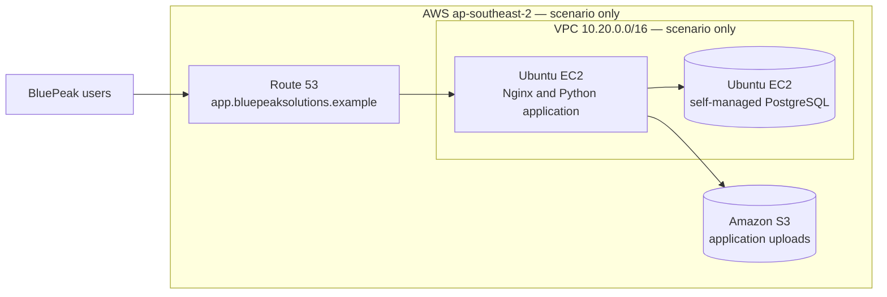
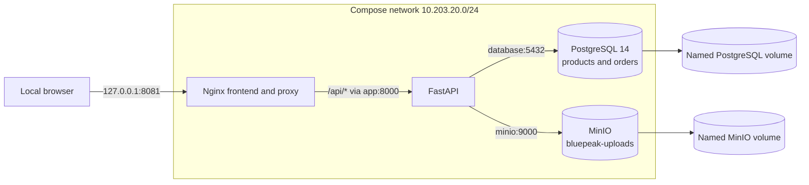

# BluePeak Source Architecture

**Evidence status:** The AWS view below is a fictional scenario and has not
been verified against AWS. The local Docker view is verified only as a
simulation.

## Scenario AWS source (not verified)

The diagram only represents the scenario statements in the customer profile.
It intentionally does not invent subnet placement, public/private routing,
security groups, load balancers, availability zones, IAM roles, or service
endpoints. Those details require authorized AWS account discovery.

## Verified local simulation

### Local service addresses and boundaries

| Component | Docker address | Host exposure | Data/flow |
|---|---|---|---|
| Nginx | `10.203.20.10` | `127.0.0.1:8081` | Serves static frontend; forwards `/api/` to FastAPI |
| PostgreSQL | `10.203.20.11:5432` | None | Stores fictional products and orders |
| MinIO | `10.203.20.12:9000` | `127.0.0.1:19000`; console at `127.0.0.1:19001` | Stores private S3-compatible test objects |
| FastAPI | `10.203.20.13:8000` | None | Uses service DNS `database` and `minio` |

Nginx is the only web entry point from the host. PostgreSQL and FastAPI are
not host-published. MinIO ports are loopback-only for local administration and
testing. The services use named volumes for local persistence.

## Observed local flows

1. The browser requests the frontend from `127.0.0.1:8081`.
2. Nginx serves static assets and sends `/api/*` requests to `app:8000`.
3. FastAPI connects to PostgreSQL at `database:5432`.
4. FastAPI sends S3-compatible health, bucket, listing, and upload requests to
   `minio:9000`.
5. Test objects remain private: unauthenticated object reads and bucket listing
   returned HTTP 403 during local validation.

## Evidence and limits

The local graph was confirmed by inspecting Compose, Docker network addresses,
volume mounts, and successful HTTP requests on 2026-11-11. The AWS graph remains
unverified. Do not interpret the Docker graph, its addresses, seed records, or
service health as an AWS inventory or production architecture.
