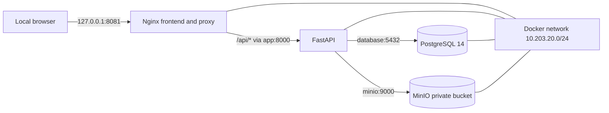

# BluePeak Source Environment Assessment

**Evidence status:** SIMULATED SOURCE DATA — NOT VERIFIED AGAINST AWS
**Assessment basis:** BluePeak scenario documentation and the local Docker Compose simulation
**Local validation date:** 2026-11-11

## Executive summary

BluePeak Solutions is described in the scenario as a fictional professional
services and consulting company with approximately 120 employees, migrating an
AWS-hosted web workload to Azure. No BluePeak AWS account, cloud inventory, or
production workload was available for inspection. The AWS estate described
below is a scenario, not an observed deployment.

The local source-workload simulation was started and validated. It consists of
Nginx, a Python/FastAPI application, PostgreSQL, and MinIO on an isolated Docker
network. The local measurements in this report apply only to that simulation.
They must not be used as estimates of production capacity or migration effort.

## Scenario-provided source assumptions

| Area | Scenario value | Verification |
|---|---|---|
| Customer and business | BluePeak Solutions; professional services; approximately 120 employees | Fictional scenario |
| Source cloud and region | AWS, `ap-southeast-2` | Not verified against AWS |
| Compute | Ubuntu Server EC2 running Nginx and a Python application | Not verified against AWS |
| Database | Self-managed PostgreSQL on EC2 | Not verified against AWS |
| Object storage | S3 bucket for application uploads | Not verified against AWS |
| Network | VPC `10.20.0.0/16` | Not verified against AWS |
| DNS | Route 53 name `app.bluepeaksolutions.example` | Not verified against AWS |

## Assessment coverage and evidence gaps

| Assessment area | Evidence available | Production evidence still required |
|---|---|---|
| Business context | Fictional professional services scenario; approximately 120 employees; AWS-to-Azure objective | Business owner, criticality, user journeys, service hours, and acceptance criteria |
| Application architecture | Scenario says Nginx and Python on Ubuntu EC2; local FastAPI/Nginx simulation verified | Source code/build artifact, deployed runtime, dependencies, integrations, traffic, and scaling needs |
| Compute and operating system | Ubuntu Server is scenario-provided; local containers have measured resource samples | EC2 IDs/types, AMI and exact OS release, CPU/memory utilization history, disks, patching, AZ placement |
| Database | Local PostgreSQL 14.24 schema, 3 products, 0 orders, 8,973,659-byte database | Actual source version, size, extensions, settings, roles, write rate, backups, RPO/RTO |
| Object storage | Local MinIO bucket, 2 test objects totaling 114 bytes, anonymous access denied | AWS bucket/region, object count/bytes, encryption, versioning, lifecycle, retention, policy |
| Network and DNS | Scenario VPC/CIDR/name; local Compose network and service addresses | AWS subnets, routes, security groups/NACLs, endpoints, DNS records/TTL, TLS and client paths |
| Identity and authorization | No source IAM configuration supplied; local API is unauthenticated | IAM roles/policies, application identities, user authentication, authorization model, audit requirements |
| Security controls | Local localhost-only bindings, non-root app, environment-based credentials, upload checks, private MinIO behavior | AWS encryption, patching, IAM, network controls, security monitoring, vulnerability findings, compliance scope |
| Availability and resilience | Local Compose health checks; dependency health checked during validation | Business availability target, AZ strategy, failover, dependency SLAs, disaster recovery design |
| Backup and recovery | Local database and MinIO named volumes persist data | Source backup schedule, retention, restore tests, recovery point/time objectives |
| Monitoring and operations | Local Docker health checks and container metrics sampled | AWS metrics/logs/alerts, on-call ownership, incident history, maintenance and runbooks |
| Constraints and risks | AWS source is explicitly simulated; no cloud access or production data used | Approved discovery access, migration window, data handling constraints, downtime tolerance, network/CIDR compatibility |

## Locally observed simulation

| Component | Observed configuration |
|---|---|
| Web entry point | Nginx 1.27 Alpine, bound to `127.0.0.1:8081` |
| Application | FastAPI 1.0.0 on Python 3.12, internal service `app:8000` |
| Database | PostgreSQL 14.24, database `bluepeak_app` |
| Object storage | MinIO `RELEASE.2025-09-07T16-13-09Z`, S3 endpoint `minio:9000` |
| Docker network | `10.203.20.0/24` |
| Persistence | Named PostgreSQL and MinIO volumes |
| Local data | 3 products, 0 orders, 2 fictional test objects totaling 114 bytes |

One `docker stats` sample during local validation showed approximately 10 MiB
for Nginx, 69 MiB for the API, 38 MiB for PostgreSQL, and 121 MiB for MinIO.
The API and MinIO showed 0.13% and 0.14% CPU in that sample; the other two
services rounded to 0%. This is a brief lab observation, not a capacity or
production sizing recommendation.

## Topology

This diagram describes the local simulation only. It is not evidence that these
components or addresses exist in AWS.

## Material unknowns

The AWS account ID, deployed resource inventory, instance sizes, operating
system release and patch level, database settings, S3 bucket policy and usage,
route tables, security groups, IAM roles, DNS records and TTLs, monitoring,
backups, availability objectives, and production traffic profile remain
unknown. Obtain authorized source-account evidence before finalizing a
production migration design.

## Readiness summary

The local application path is demonstrable and has a measurable baseline.
Production migration readiness cannot be concluded until the source facts and
business requirements above are confirmed with the customer and account
owners.
